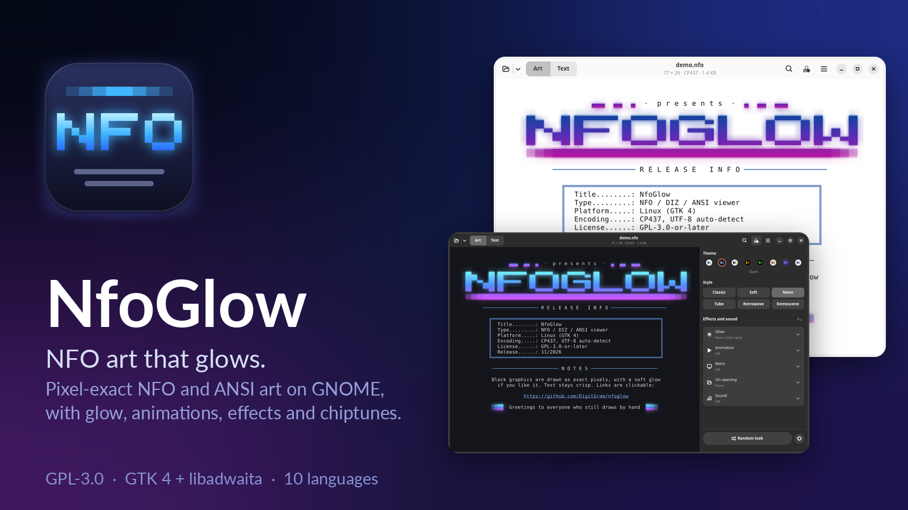
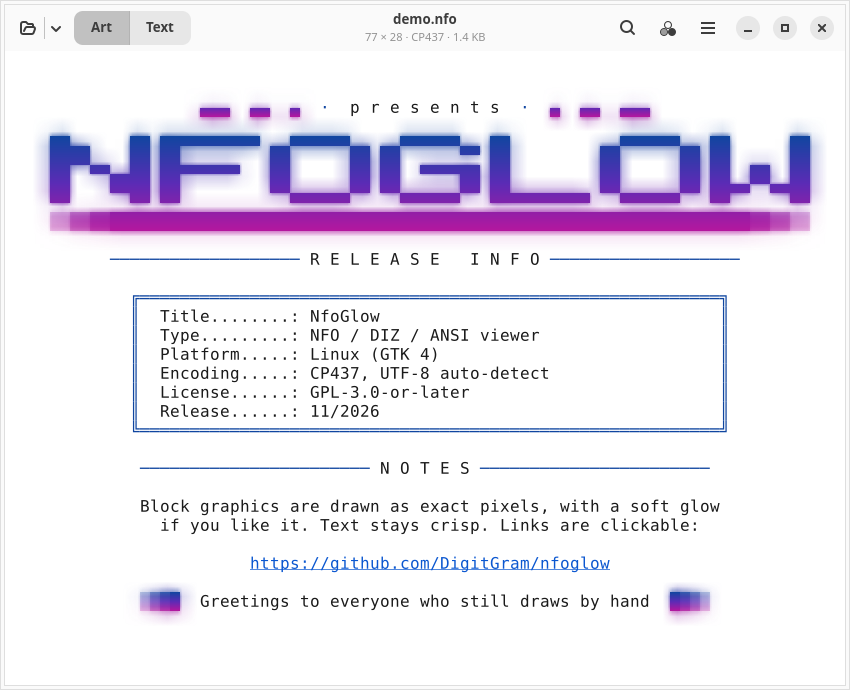
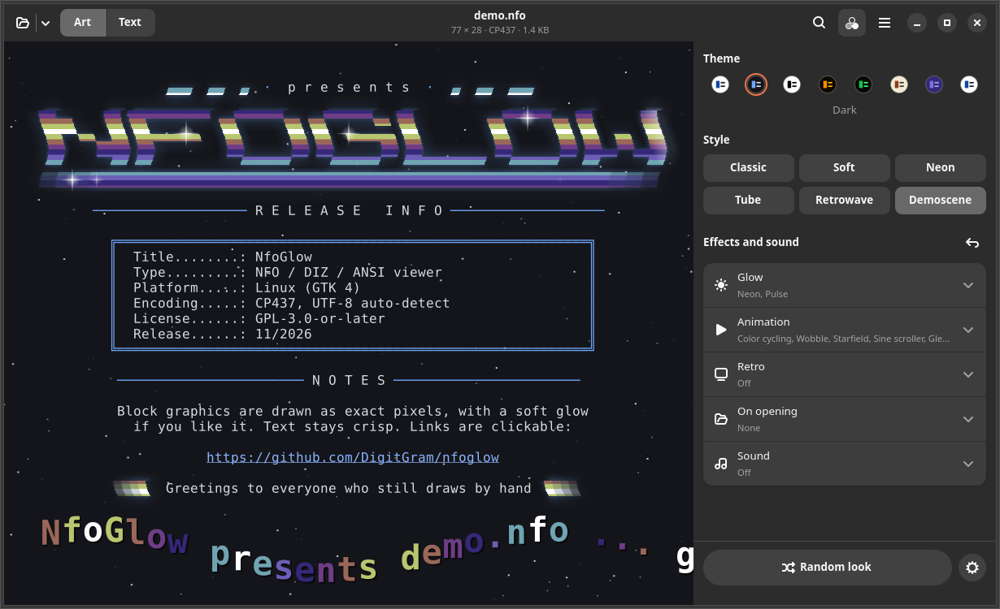
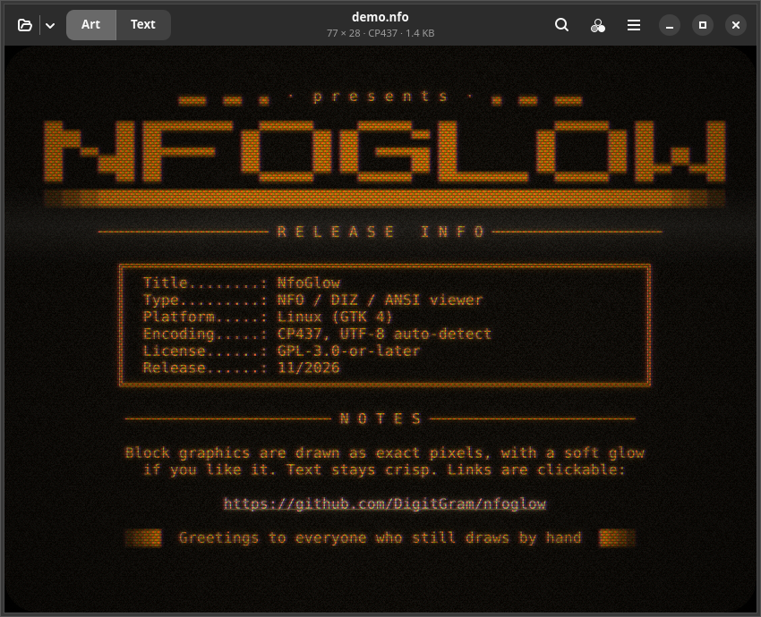
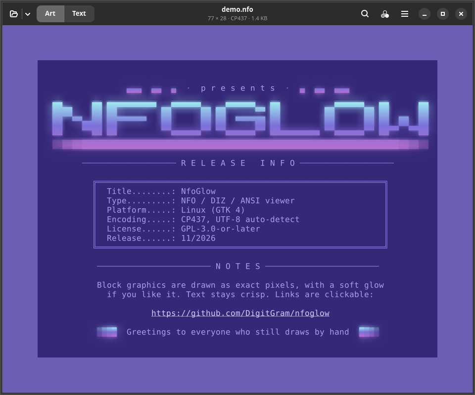

<p align="center">
  
</p>

# NfoGlow

[](https://github.com/DigitGram/nfoglow/actions/workflows/test.yml)

**NFO and ANSI art, the way the scene meant it.** A viewer for `.nfo`, `.diz` and `.ans` files on Linux,
inspired by the Windows classic [iNFekt](https://github.com/syndicodefront/infekt).
More on the [project website](https://digitgram.github.io/nfoglow/).

Most text viewers draw the block characters `█ ▀ ▄ ░ ▒ ▓` with a font, which leaves gaps and seams in the art.
NfoGlow paints them as exact pixels, optionally with a soft glow, and keeps the text crisp.

<p align="center">
  <picture>
    <source media="(prefers-color-scheme: dark)" srcset="docs/screenshots/dark.png">
    
  </picture>
</p>

## What you get

- **Clean art.** Block graphics as exact pixels without seams.
- **Glow, and more.** Soft edges or a neon glow behind crisp blocks, in five strengths,
  with an optional flicker like an old sign; a soft phosphor glow around the text; a colour ramp that runs through every
  block of art; and scanlines, a shadow mask or an aperture grille like an old monitor, or a live CRT with a
  rolling bar, flicker, picture noise and round corners, plus a colour fringe like an old tube or a VHS tape, and the
  IBM VGA font of the old PCs for the text. All in the Effects sidebar (F9), which moves the NFO aside instead of
  covering it.
- **Styles.** Classic (no effects), Soft, Neon, Tube, Retrowave and Demoscene set all effects with one click; every
  effect can still be fine-tuned on its own.
- **Demoscene mode.** Colour cycling in C64 colours (or your own), a wobbling
  logo, drifting or warp stars, a sine scroller, a gleam that sweeps across the art, sparkles, and a neon
  glow that pulses to the beat of the music. On opening, one of eight effects (a choice, with a preview
  button): modem build-up (line by line, like a 2400 baud BBS), glitch, C64 tape loader (`LOAD"…",8,1`, then coloured
  stripes in the border), CRT power-on, DOS boot (boot message, `VER`, `DIR` and `TYPE` of the file), dither fade-in (░ ▒ ▓ █), a neon flicker-on or a code rain of ones and zeros that leaves the NFO behind. Off by default; animations only run while the window is visible.
- **Random look.** Roll a new combination of theme, glow, colours, animation, tube and opening effect with one click, keep the
  one you like, or get a new look at every start. Your settings stay until you keep one. Undo (Ctrl+Z) takes
  back any change to the look, step by step.
- **Music.** Nine built-in chiptunes by Stennish, each with its intro and a seamless loop, or your own folder of MOD,
  XM, S3M and IT tracks (e.g. from [The Mod Archive](https://modarchive.org)) or OGG, MP3, FLAC and WAV, in random order or in a row. Fades in; off by default.
- **CP437 out of the box.** UTF-8 files are detected, and NFOs that an editor broke into UTF-8 (`ÛÛÛ` instead
  of `███`) are repaired. CP850 and Latin-1 can be chosen by hand.
- **ANSI art in colour.** 16 colours with iCE colours, 256 colours, true colour and cursor movement; SAUCE is read.
- **Browse a release folder** with ← and →, open the NFO **straight from a ZIP or a ReScene `.srr`**, and pick from
  the **recent files** on the Open button.
- **Reloads by itself** when the file changes, handy while you draw an NFO (F5 also works).
- **Text only.** One click (Ctrl+T) hides the art and shows just the release info.
- **Copy without the art.** Selecting and copying skip block and line graphics (can be turned off).
- **Share your look.** Main menu > Look > Copy look puts one line of text (`nfoglow:1:…`) on the clipboard; whoever
  pastes it with Paste look gets your theme, colours, effects and the DOS font (Ctrl+Z undoes it). Nothing else is shared: no paths,
  no music folder, no file list.
- **Search** with highlighting (Ctrl+F), **clickable web and e-mail links**, **zoom** (Ctrl + wheel, Ctrl +/−/0, fit width).
- **Seven themes plus your own colours:** Light, Dark, Black & White, Amber, Terminal, Paper, C64 (the blue screen in its
  light blue border) and Custom; any monospace font. Each theme brings a colour ramp of its own that matches it
  (until you set the ramp by hand).
- **Save as PNG or PDF** (Ctrl+S); the PDF keeps the text selectable. From the shell: `nfoglow --png out.png file.nfo`
  (or `out.pdf`).
- **Native look.** GTK 4 and libadwaita, in ten languages: English, German, Spanish, French, Italian, Brazilian
  Portuguese, Polish, Ukrainian, Japanese and Simplified Chinese.

<p align="center">
  
  
  
</p>

<p align="center"><sub>More screenshots on the <a href="https://digitgram.github.io/nfoglow/#gallery">project website</a>.</sub></p>

## Requirements

- A desktop with GTK 4 and libadwaita 1.5 or newer, for example GNOME 46 or newer: Ubuntu 24.04 or newer, Fedora 40 or newer, Debian 13 or newer, Linux Mint 22 or newer. On other desktops the libadwaita package may need to be installed.
- Python 3 as the system's `/usr/bin/python3`, with GTK 4, libadwaita >= 1.5 and pycairo for Python
  - Debian/Ubuntu: `sudo apt install python3-gi python3-gi-cairo gir1.2-adw-1`
  - Fedora: `sudo dnf install python3-gobject libadwaita`
  - Arch: `sudo pacman -S python-gobject python-cairo libadwaita`
- Optional, for music: GStreamer with its Python bindings (Debian/Ubuntu: `gir1.2-gstreamer-1.0 gstreamer1.0-plugins-good`; the tracker formats MOD, XM, S3M and IT need the openmpt plugin from `gstreamer1.0-plugins-bad`). Without it NfoGlow works, just without music.

Older systems are not supported; the installer stops with an install hint.

## Install

One line (installs for the current user only, no root):

```sh
curl -fsSL https://github.com/DigitGram/nfoglow/releases/latest/download/install.sh | bash

# no curl (e.g. a fresh Ubuntu)? wget does the same:
wget -qO- https://github.com/DigitGram/nfoglow/releases/latest/download/install.sh | bash
```

Prefer to read the script first? Download it, inspect it, then run it:

```sh
curl -fsSLO https://github.com/DigitGram/nfoglow/releases/latest/download/install.sh
less install.sh && bash install.sh
```

Or from a checkout: `git clone https://github.com/DigitGram/nfoglow && cd nfoglow && ./install.sh`.
Running the one-line installer of a newer release updates an existing installation; log out and in once if the
launcher or icon is missing. NfoGlow opens `.nfo`, `.diz` and `.ans` files when no other program is set for them;
otherwise choose it once under *Open With*.

To remove it:

```sh
~/.local/share/nfoglow/install.sh --uninstall   # your settings in ~/.config/nfoglow are kept
~/.local/share/nfoglow/install.sh --purge       # removes the settings too
```

### Verify the download

Releases are signed with the key of `digitgram@proton.me`, fingerprint
`E7AA EB31 A4DE CF99 B314 7E1D FAAB 30B5 FD49 0E93`.

```sh
curl -fsSL https://github.com/DigitGram.gpg | gpg --import
curl -fsSLO https://github.com/DigitGram/nfoglow/releases/latest/download/install.sh
curl -fsSLO https://github.com/DigitGram/nfoglow/releases/latest/download/install.sh.asc
gpg --verify install.sh.asc install.sh
```

Run the script only if gpg reports a good signature and the fingerprint matches the one above. The signed script
names the exact commit it downloads, so the signature covers the program as well, not just the installer.

### Flatpak

`flatpak/io.github.digitgram.NfoGlow.yml` builds a Flatpak on the GNOME 51 runtime. It reads your home folder (read-only)
so that ← and → can step through the other NFOs of a folder and your music folder stays reachable; it writes only
where you save an export. The runtime has no tracker music, so the Flatpak builds libopenmpt and the GStreamer
plugin for MOD, XM, S3M and IT itself (the first build takes a few minutes longer):

```sh
flatpak-builder --user --install --force-clean build flatpak/io.github.digitgram.NfoGlow.yml
```

## Privacy

NfoGlow makes no network connections of its own, and the Flatpak has no network access. A click on a link in an NFO
hands it to your web browser. The list of **recent files** is kept only in your settings file
(`~/.config/nfoglow/settings.json`) on your computer. Turn it off under Settings → General → Remember recent files;
that also clears the list.

## Keyboard

| Keys | Action |
| --- | --- |
| Ctrl+O | Open |
| ← → | Previous, next NFO in the folder |
| Space, Shift+Space | Page down, up |
| F5, Ctrl+R | Reload |
| Ctrl+F, Enter, Shift+Enter | Search, next, previous match |
| Ctrl+T | Art or text only |
| F9 | Effects sidebar |
| Ctrl+Z | Undo the last change to the look |
| Ctrl+M | Music on or off |
| Ctrl+C, Ctrl+A | Copy (the selection, or everything), select all |
| Ctrl+Plus, Ctrl+Minus, Ctrl+0 | Zoom in, out, back to the default zoom |
| Ctrl+S | Save as PNG |
| Ctrl+, | Preferences |
| Ctrl+? | All keyboard shortcuts |
| Ctrl+W, Ctrl+Q | Close window, quit |

## Command line

```sh
nfoglow FILE...                    # open files, one window each
nfoglow --png OUT.png FILE         # render FILE to an image, with your theme and font
nfoglow --png OUT.pdf FILE         # or to a PDF; the text stays selectable
nfoglow --version
```

Rendering needs no window, so it works in a script or on a server. A page too long for a PNG (over 32767 pixels, or
about 100 megapixels) is refused with a hint to save a PDF instead.

## Translating

Translations are plain gettext `.po` files in `po/`, read directly at runtime. German is maintained by the author.
All other translations were generated by an AI assistant and have not been reviewed by native speakers;
corrections are welcome as pull requests. How to add a language: [docs/development.md](docs/development.md#translating).

## Development

Project layout, how it works, running the tests and trying the window by hand: [docs/development.md](docs/development.md).

## How it was made

NfoGlow is developed and maintained by DigitGram. The project is shaped by its requirements, design decisions and ongoing development.

AI-assisted tools were used during implementation and to support code quality improvements, testing, hardening and translations. All changes are reviewed and tested by the author, who is responsible for the final result.

The code is open, the test suite is available in `tests/`, and issues and pull requests are welcome.

## Support

NfoGlow is free and stays free. If it is useful to you, you can support its development on [GitHub Sponsors](https://github.com/sponsors/DigitGram) or [Liberapay](https://liberapay.com/DigitGram). Donations are voluntary and unlock nothing.

## License

Copyright (C) 2026 DigitGram. NfoGlow is free software: you can redistribute it and/or modify it
under the terms of the [GNU General Public License](LICENSE) as published by the Free Software
Foundation, either version 3 of the License, or (at your option) any later version. It comes without
any warranty. The icon is part of the project and under the same license; the music and the font below are not.
Inspired by iNFekt by syndicode.

The built-in music is by **Stennish** ([chiptunes](https://soundcloud.com/autistgamer1337/sets/chiptunes)),
licensed under [CC BY 4.0](https://creativecommons.org/licenses/by/4.0/); see [data/music](data/music/README.md)
for the tracks and what was changed. Thank you, Stennish!

The DOS font is PxPlus IBM VGA 8x16 from [The Ultimate Oldschool PC Font Pack](https://int10h.org/oldschool-pc-fonts/)
by **VileR**, licensed under [CC BY-SA 4.0](https://creativecommons.org/licenses/by-sa/4.0/) and included unchanged;
see [data/fonts](data/fonts/README.md). Thank you, VileR!
